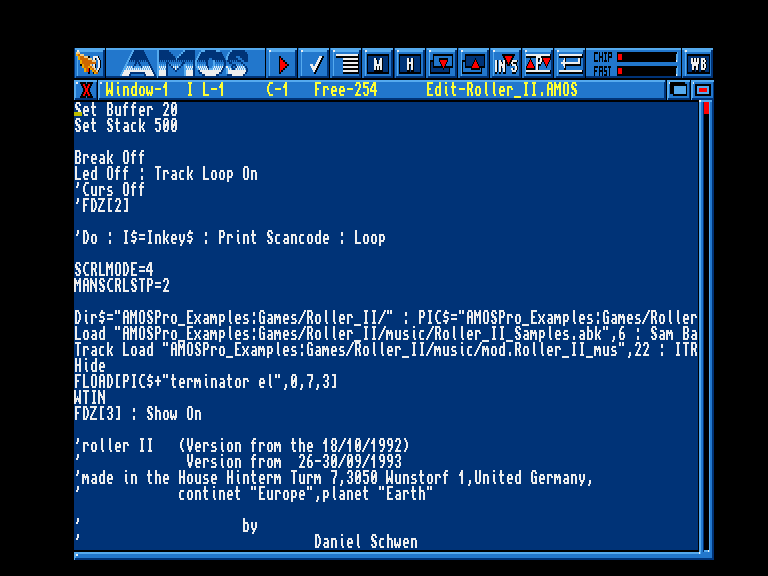
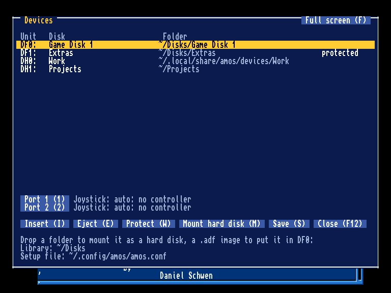
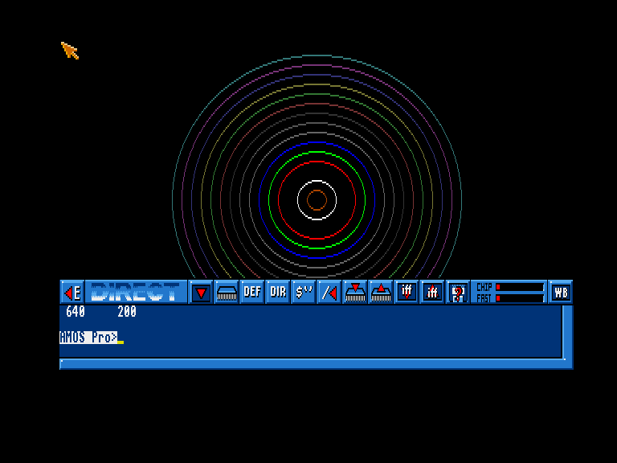

# AMOS Professional on Linux, Windows and macOS: user manual

This manual covers what the host computer adds to AMOS Professional:
- starting AMOS and opening programs;
- the window, full screen and the keyboard;
- disks and drives, made from folders and `.adf` images;
- the Devices panel (F12) and joysticks;
- the system clipboard;
- the settings file and where AMOS keeps its files.

The AMOS language and the editor work as in the original AMOS Professional manual. Differences
between the three systems are marked **Windows**, **macOS** or **Linux**, and summed up in the table
at the end.

## 1. Installing and starting

| | Install | Start |
|---|---|---|
| **Windows** | `amos-VERSION-windows-x64.msi`: installs into Program Files and adds a Start menu entry | Start menu, *AMOS Professional* |
| **macOS** | the `.dmg` for your Mac (*arm64* for Apple Silicon, *x86_64* for Intel): drag *AMOS Professional* to *Applications* | Launchpad or Finder |
| **Linux** | the `.deb` (`sudo apt install ./amos_VERSION_amd64.deb`), or unpack the `.tar.xz` anywhere | `amos` in a terminal, or the desktop's application menu (`.deb`) |

**First launch on macOS.** The app is not notarized by Apple, so macOS blocks it the first time.
To allow it:
- Open *System Settings → Privacy & Security*, find "AMOS Professional was blocked" and click
  *Open Anyway*.
- On macOS 14 and older you can instead Control-click the app and choose *Open*.
- Either way, you only need to do this once.

**First launch on Windows.** The installer is signed. SmartScreen may still show "Windows protected
your PC" for a new release; click *More info*, then *Run anyway*.

### From the command line

```
amos                       the editor
amos prog.AMOS             runs the program, then the editor
amos-player prog.AMOS      runs the program only: no editor, AMOS ends when the program does
amos --open-document prog.AMOS   loads the program into the editor without running it
```

Where to find `amos` on each system:
- **Windows**: `amos.exe` and `amos-player.exe` are in the installation folder, normally
  `C:\Program Files\AMOSystem`.
- **macOS**: both are inside the app: `"/Applications/AMOS Professional.app/Contents/MacOS/amos"`.
- **Linux**: `amos` and `amos-player` are in `bin/` of the tarball, or on the `PATH` after
  installing the `.deb`.

### Opening `.AMOS` files from the desktop

A double click on an `.AMOS` file opens it in the editor; it does not run it. A program that is
already open is not affected: each file you open gets an AMOS of its own.

How AMOS becomes the program for `.AMOS` files:
- **Windows**: the installer offers AMOS for `.AMOS` files. Making it the default is your choice:
  *Open with → AMOS Professional → Always*.
- **macOS**: the app registers itself for `.AMOS` files. If another app has claimed them, use
  *Get Info → Open with → AMOS Professional → Change All*.
- **Linux**: the `.deb` registers the file type (`application/x-amos-program`). The tarball does
  not; start it from the terminal.

## 2. The window



**Size.**
- The picture is magnified: twice on Linux and macOS, once on **Windows**.
- `AMOS_SCALE=3` (any value from 1 to 9) chooses another magnification.
- You can resize the window freely. The picture keeps its shape, with black bars where needed.

**Full screen.**

| | Switch full screen on or off |
|---|---|
| **Windows**, **Linux** | **Alt+Enter** |
| **macOS** | **Option+Return**; the green window button, Control+Command+F and Globe+F also work |
| Every system | *Full screen* / *Window* button at the top right of the F12 panel (key `F`) |

- `amos --fullscreen` starts in full screen.
- The panel's *Save* remembers the choice for next time.
- Full screen uses the desktop's own resolution, so the display mode never changes.
- **macOS**: full screen opens in a Space of its own, as for any Mac app.
- F11, the usual full-screen key, is the Amiga's **Help** key here.

**The mouse.**
- While AMOS is in front, it owns the mouse and the system pointer is hidden.
- The pointer comes back while the F12 panel is open.
- It also comes back when AMOS goes behind the Workbench (Amiga-A, as on the Amiga). The title bar
  then says so; click in the window to bring AMOS back.

**Closing the window** quits AMOS at once, without asking to save. Save your program first.

### The keyboard

| Amiga key | Windows / Linux | macOS |
|---|---|---|
| Left Amiga, Right Amiga | the Windows (Super) keys | **Command** |
| Alt | Alt | Option |
| Help | F11 | F11 (Fn+F11 on most Mac keyboards) |
| Del | Delete | Delete (Fn+Backspace on a laptop) |
| Ctrl | Ctrl (either) | Control (either) |

On **Windows** and **Linux** the system may take some Windows-key (Super) combinations for itself
before AMOS sees them. For example, Win+A opens the quick settings on Windows 11, and GNOME takes
Super alone. **macOS** passes Command combinations to AMOS, apart from the system's own: Command+Q,
Command+Tab and Command+Space.

## 3. Disks and drives

AMOS has the Amiga's drives:
- **DF0:–DF3:**, the floppy drives (two by default);
- **DH0:–DH9:**, the hard disks.

A **disk** is a folder of your computer, or an Amiga floppy image (`.adf`). The disk's name (its
*label*, such as `Work:` or `Game Disk 1:`) is the folder's name, or the image's own label, unless
you give it another. A program can use a disk by either name: `Load "df0:pic.iff"` or
`Load "Game Disk 1:pic.iff"`.

These volumes are always there:

| Name | What it is |
|---|---|
| `START:` | the folder AMOS was started from, or the folder of the program it was started with |
| `RAM:` | a temporary folder, empty at every start and deleted when AMOS ends |
| `AMOSPRO:` and the system assigns | AMOS's own files |
| `DOCUMENT:` | the folder of a program opened from the desktop |
| the folders of the *devices folder* | each one a hard disk, labelled with its name. A new devices folder starts with `Work` (section 7 says where it is). |

### Putting a disk in

You can do it in any of these ways:
- **Drop it on the window.** A folder becomes the next free hard disk. An `.adf` goes into `DF0:`.
  A dropped `.AMOS` program opens in an AMOS of its own (not on **Windows**, see below).
- **The F12 panel** (section 4): put a folder or image into any drive, take it out, mount hard
  disks.
- **The command line**:
  ```
  amos --df0 Game1.adf --df1 "~/disks/Game 2=Game Disk 2" --dh1 ~/amiga/Work,ro prog.AMOS
  ```
  Each value is `path[=label][,ro]`; `,ro` makes the disk write-protected.
- **The settings file** (section 7), for disks that should be there at every start.

**Disk images (`.adf`)** are always write-protected. A program that tries to save to one gets the
Amiga's "disk is write protected" error. AMOS unpacks the image into a temporary folder and never
changes the image. Both OFS and FFS images work, in double density (880 KB) and high density
(1.76 MB).

**When a program asks for a disk that is not there**, AMOS's "Please insert volume X" requester
appears. The bottom of the window then says *"Please insert the disk X: drop its folder on this
window, or press F12"*. Put the disk in (drop it, or use the panel) and the requester goes away by
itself, just as it did when you put the floppy in on the Amiga.

**The library** is a list of folders where AMOS looks for disks by name. With
`~/Documents/AMOS Disks` in the library, a program that asks for `Utility:` finds the folder
`Utility` or the image `Utility.adf` there without any help from you. Set it in the settings file
(`[library]`) or with `--library folder`.

### Names

- AmigaDOS ignores upper and lower case in names, so AMOS does too, on every system.
- The case of names on disk is kept.
- **Windows** has no drive letters inside AMOS: to use `D:\Games`, mount that folder as a disk.

## 4. The Devices panel (F12)

Press **F12** anywhere, in the editor or while a program runs. The panel appears over AMOS's
picture, and the program keeps running behind it. F12 or Esc closes it.



Paths are shown with your home folder as `~`. You can use the panel with the mouse (click a row
or a button; a double click on a drive means *Insert*)
or with the keyboard:

| Key | Action |
|---|---|
| Up / Down | choose a drive |
| `I` or Enter | **Insert**: choose a folder or an `.adf` for the selected drive (a disk already in it is ejected first, as on the Amiga) |
| `E` | **Eject** the disk of the selected drive |
| `W` | **Protect**: write-protect the disk, or allow writing again (images stay protected) |
| `M` | **Mount hard disk**: a folder as the next free DH drive |
| `1`, `2` | the joystick of port 1 or port 2 (section 5) |
| `F` | full screen or the window |
| `S` | **Save** the drives, joysticks and full screen to the settings file (shown at the bottom) |
| Esc, F12 | close |

**Choosing a folder.**
- *Insert* and *Mount* open a small file browser in the same panel. It starts in your first library
  folder, or else where AMOS was started.
- Up/Down and PageUp/PageDown move; Enter opens a folder; Backspace goes up a folder.
- **[ Use this folder ]** chooses the folder you are in.
- Enter on an `.adf` file puts that image in the drive at once.
- Esc goes back to the panel.

*Save* keeps the rest of the settings file as it was, and keeps the previous version as
`amos.conf.bak`.

## 5. Joysticks

The Amiga had two joystick ports:
- **port 1** is `Joy(0)`, the mouse's port;
- **port 2** is `Joy(1)`, where most games expect the joystick.

Either port can be given:
- **a game controller**: Xbox, PlayStation, Switch Pro and most other USB or Bluetooth pads. The
  d-pad or the left stick moves; **A, B, X or Y** is fire.
- **the keyboard**: the cursor keys move, and **either Ctrl** is fire. The keys still reach AMOS
  as well.
- **none**.

By default (*auto*) the first controller connected goes into port 2 and a second one into port 1.
Controllers can be plugged in and out while AMOS runs.

In the F12 panel, **Port 1** and **Port 2** (keys `1` and `2`) step through *auto, none, keyboard*
and each connected controller. *Save* keeps the choice. To set it for one session only:

```
amos --port2 keyboard game.AMOS          (auto, none, keyboard, pad1, pad2...)
```

Controllers work the same way on all three systems.

## 6. The system clipboard

The editor can copy and paste text to and from other programs:

| | Copy | Cut | Paste |
|---|---|---|---|
| **Windows**, **Linux** | Ctrl+Shift+C | Ctrl+Shift+X | Ctrl+Shift+V |
| **macOS** | Command+C | Command+X | Command+V |
| Every system | the editor's **Clipboard** menu: *System Copy*, *System Cut*, *System Paste* | | |

On Windows and Linux, plain Ctrl+C, Ctrl+X and Ctrl+V remain AMOS's own block commands, as in the
original.

**In the editor:**
- Mark a block with AMOS's block marker (Ctrl+B in the standard setup) and move the cursor to its
  other end, then copy or cut.
- What is copied is plain BASIC text, as you would type it.
- Paste inserts at the cursor or replaces the marked block.
- Each paste or cut is one step of *Undo*.



**In direct mode:**
- Shift with the cursor keys, Home or End (or Shift with a mouse click) selects.
- Copy without a selection copies the whole line.
- Pasting never runs the command; press Return to run it. Only one line can be pasted.

**Limits:**
- The text must be in the Latin-1 range: accented letters work, emoji do not.
- Tabs become one space each.
- A text over 1 MB, or with a line too long for AMOS (more than 250 characters), is refused with a
  message.
- Open a folded procedure before copying a block that contains it.

## 7. Settings and files

### The settings file `amos.conf`

The *Save* button of the F12 panel writes this file. You can also edit it yourself. The panel shows
its path at the bottom. A full example:

```ini
[df0]
path = ~/Disks/Game1.adf
[df1]
path = ~/Disks/Game2
label = Game Disk 2
readonly = yes
[dh1]
path = ~/amiga/Work
[library]
path = ~/Documents/AMOS Disks
path = ~/Downloads
[assign]
FONTS = ~/amiga/Fonts
[devices]
floppy_drives = 2              # 0-4
directory = ~/AMOS/devices     # the devices folder: each folder in it a hard disk
[window]
fullscreen = no
[joystick]
port1 = auto                   # auto, none, keyboard, pad1, pad2...
port2 = keyboard
[extensions]
9 = AMOSPro_AMCAF.Lib          # an extension in a slot (section 8)
```

How paths are written:
- `~` is your home folder. On **Windows** that is `C:\Users\you`, and `\` or `/` both work.
- A relative path is relative to the file's own folder.

**Precedence, highest first:**
1. the command line;
2. a **profile**: `Name.amos.conf` beside the program `Name.AMOS` (useful for a game that needs
   its own disks);
3. your `amos.conf`;
4. the built-in defaults.

`--config file` uses another settings file.

### Command-line options

| Option | |
|---|---|
| `--df0` … `--df3`, `--dh0` … `--dh9` `path[=label][,ro]` | a disk in that drive |
| `--assign NAME=path` | an assign |
| `--library folder` | a library folder (can be given more than once) |
| `--devices folder` | the devices folder |
| `--config file` | the settings file to use (and to save to) |
| `--fullscreen` | start in full screen |
| `--port1`, `--port2` `auto\|none\|keyboard\|padN` | the joysticks |
| `--extension SLOT=FILE` | an extension in a slot (1 to 26); an empty FILE frees the slot |
| `--open-document file` | open a program in the editor without running it |

### Where AMOS keeps its files

| | **Linux** | **macOS** | **Windows** |
|---|---|---|---|
| settings (`amos.conf`) | `~/.config/amos/` | `~/.config/amos/` | `%LOCALAPPDATA%\AMOSystem\` |
| devices folder (hard disks, `Work`) | `~/.local/share/amos/devices` | `~/.local/share/amos/devices` | `%LOCALAPPDATA%\AMOSystem\devices` |
| your copy of the system files (editor configuration, macros) | `~/.local/share/amos/runtime` (`.deb`; the tarball runs in its own folder if you can write to it) | `~/Library/Application Support/AMOSystem/runtime` | `%LOCALAPPDATA%\AMOSystem\runtime` |
| `RAM:` and unpacked `.adf` images | the temporary folder (`$TMPDIR`, else `/tmp`), removed at the end | the same | the user's temporary folder |

- **Linux** and **macOS** follow `XDG_CONFIG_HOME` and `XDG_DATA_HOME` when they are set.
- Uninstalling AMOS removes none of these folders, so your disks, settings and macros survive an
  upgrade.
- A `devices` folder in the folder AMOS is started from is used instead of the default one.

### Environment variables

| Variable | |
|---|---|
| `AMOS_SCALE` | the window's magnification, 1–9 |
| `AMOS_CONFIG` | the settings file |
| `AMOS_DEVICES` | the devices folder |
| `AMOS_ASSIGNS` | `NAME=path;NAME=path...`: assigns |
| `AMOS_HOME` | another AMOS system tree (for developers) |
| `AMOS_DISPLAY=none` | no window and no sound (text-only programs, scripts) |

## 8. Extensions

AMOS Professional's extensions add commands to the language. The four of AMOS itself (Music, Compact,
Request, IO_Ports) are always there. Two more, by other authors, are built into this version and
set up in their usual slots:

| Slot | Extension | What it is |
|---|---|---|
| 8 | **AMCAF** V1.50beta4 | fast maths, strings and banks, the Protracker player, blitter, C2P, fonts... |
| 12 | **Turbo Plus** V2.15 | pixels, planes, scenes, objects, stars, memory search... |

(The releases' configuration puts them there; a build you made yourself runs without until you say
so, see below.) A program saved with their commands holds the slot, so it needs the extension in the
slot it was written for; Editor → About Extensions lists what is loaded.

**Putting an extension in another slot**, or freeing one: the setup file's `[extensions]` section or
`--extension` on the command line (section 7), or AMOS's own configuration (the extensions are the
interpreter configuration's file names, the slot their number):

```
amos --extension 9=AMOSPro_AMCAF.Lib prog.AMOS
```

The name is the library's file name, whether or not the file is there: the code is the C++ of this
version, not the original library. **Not every command is there yet**: one that is not raises an AMOS
error ("This command is not available in this version of the extension"). Programs that use them
still list, edit and save correctly. `docs/THIRD-PARTY-EXTENSIONS.md` has the plan and
`data/extensions/*.json` says which command is done.

## 9. The differences at a glance

| | **Windows** | **macOS** | **Linux** |
|---|---|---|---|
| Package | signed MSI | DMG (Apple Silicon or Intel), not notarized: *Open Anyway* once | `.deb` or `.tar.xz` |
| Window magnification | 1× | 2× | 2× |
| Full screen | Alt+Enter | Option+Return, green button, Ctrl+Cmd+F | Alt+Enter |
| Amiga keys | Windows keys (some combinations taken by Windows) | Command | Super keys (some taken by the desktop) |
| Help key | F11 | Fn+F11 | F11 |
| System clipboard | Ctrl+Shift+C/X/V | Command+C/X/V | Ctrl+Shift+C/X/V |
| Double click on `.AMOS` | after *Open with → Always* | yes | with the `.deb` |
| `.AMOS` dropped on the window | not yet (shows "Cannot open") | opens in a new AMOS | opens in a new AMOS |
| Settings file | `%LOCALAPPDATA%\AMOSystem\amos.conf` | `~/.config/amos/amos.conf` | `~/.config/amos/amos.conf` |
| Your disks (devices folder) | `%LOCALAPPDATA%\AMOSystem\devices` | `~/.local/share/amos/devices` | `~/.local/share/amos/devices` |
| Drive letters | mount the folder (no `C:` in AMOS) | – | – |

The rest is the same on all three systems:
- the F12 panel, drag and drop of folders and `.adf` images, disk images, the library;
- joysticks, profiles and the command-line options.

## 10. Not there yet

- Writing to `.adf` images, and creating new blank floppies (images are read-only for now).
- Hard disk images (`.hdf`): use a folder as the hard disk.
- The system's own file dialog in the F12 panel (the built-in browser is used everywhere).
- Amiga protection bits and file comments are not kept on the host's files.
- Library calls of AmigaOS from BASIC (`Doscall`, `Execall`, `Lib Call`) do nothing and return 0;
  the serial port has nothing behind it. docs/BUILDING.md lists every difference from the Amiga.
